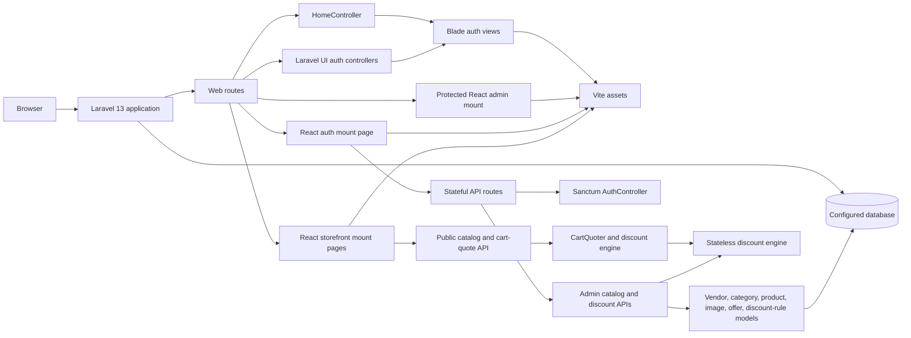

# Architecture Overview

## Current Shape (Verified)

This Laravel application serves React storefront, authentication, and admin catalog pages through Blade mount views. React uses same-origin JSON APIs with Sanctum stateful sessions. Admin JSON routes add a dedicated admin middleware check. The public storefront reads the catalog and prices a guest cart through stateless public endpoints. Vite builds the CSS, Sass, and JavaScript entry points. There is no Inertia or Livewire integration.

## Evidence and Boundaries

- Verified package/runtime versions and the live schema snapshot are recorded in [current state](../status/current-state.md).
- The active route surface and API distinction are in [API and routes](../api/README.md).
- Detailed layers are described in [backend](backend.md), [frontend](frontend.md), [database](database.md), and [security](security.md).
- Confirmed marketplace requirements and implementation status are recorded in [product requirements](../product/requirements.md).