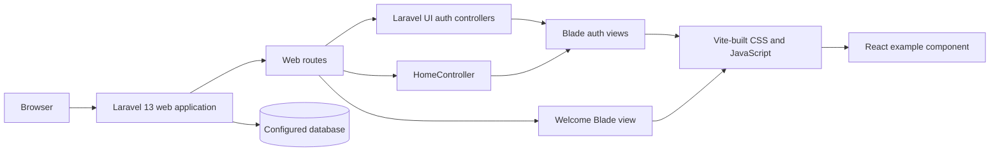

# Architecture Overview

## Current Shape (Verified)

This is a server-rendered Laravel application. The request entry point is Laravel routing in `routes/web.php`; route handlers return Blade views or delegate the authenticated home route to a controller. Laravel UI provides the web authentication route/controller scaffolding. Vite builds the CSS, Sass, and JavaScript entry points. There is no verified SPA framework, Inertia, Livewire, domain service layer, or application API in the current route list.

## Evidence and Boundaries

- Verified package/runtime versions and the live schema snapshot are recorded in [current state](../status/current-state.md).
- The active route surface and API distinction are in [API and routes](../api/README.md).
- Detailed layers are described in [backend](backend.md), [frontend](frontend.md), [database](database.md), and [security](security.md).
- Future domain architecture is not proposed here because product requirements are not established.