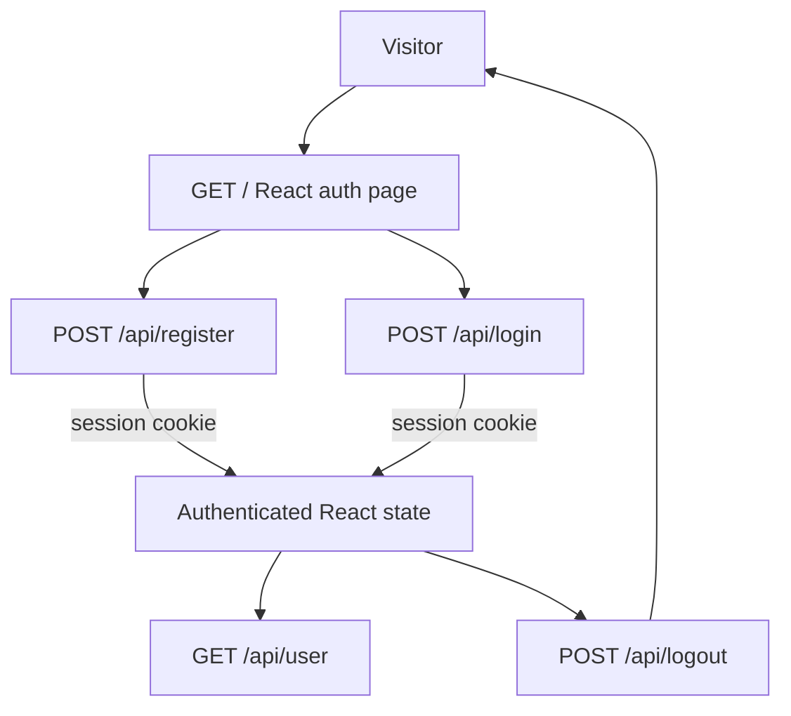

# User Flows

## Current React/API Authentication Flow

The React page first requests `/api/user`; the expected unauthenticated response displays sign-in. Registration and login obtain the Sanctum CSRF cookie before submitting. Logout invalidates the session. Laravel UI web auth and password reset routes remain available separately.

## Existing Web Flow

The route list confirms the Laravel UI login/register, logout, password confirmation/reset, and authenticated home routes. Laravel UI supplies this web flow. Email verification controller and view files exist, but the route list does not expose verification routes.

## Product Flows Not Yet Defined

Vendor and buyer catalog/order journeys remain unimplemented; see [product requirements](requirements.md) for the confirmed task scope.