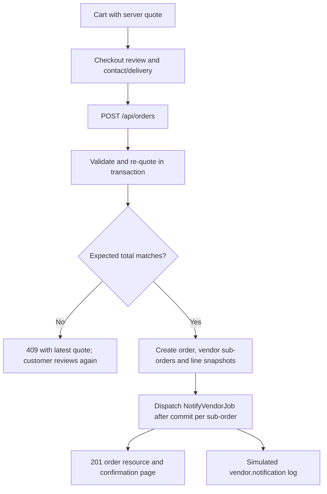
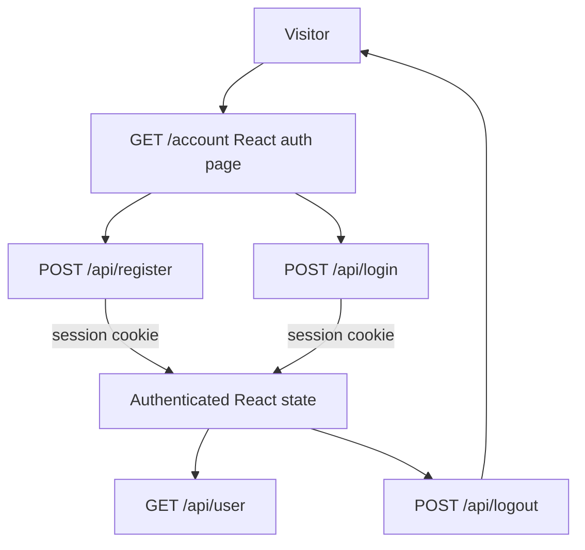
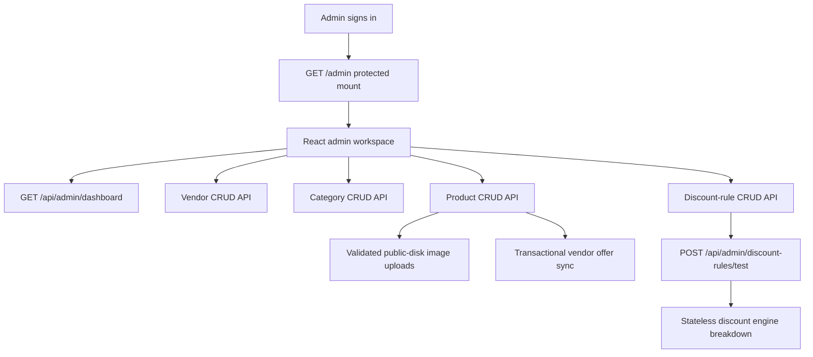

# User Flows

## Storefront Shopping Flow

```mermaid
flowchart TD
    Guest[Guest] --> Home[GET / storefront SPA]
    Home --> Shop[GET /api/products search/sort/page]
    Home --> Categories[GET /api/categories]
    Categories --> Category[GET /api/categories/{id} and its products]
    Shop --> Detail[GET /api/products/{product}]
    Detail --> Add[Add {product_id, vendor_id, quantity} to cart]
    Add --> Persist[Persist lines to localStorage]
    Persist --> Quote[POST /api/cart/quote debounced]
    Quote --> Quoter[CartQuoter resolves offers and runs the engine]
    Quoter --> Totals[Per-line discounts and per-vendor totals]
```

Guests can browse and build a cart without registering. The browser stores only product/vendor IDs and quantities and never computes prices; the storefront posts the cart to the stateless quote endpoint, which resolves the selected or lowest active offer per line, applies discount rules, and returns line and per-vendor totals. The cart survives a page refresh via `localStorage`.

## Checkout and Order Flow



Checkout supports guests and signed-in customers. The server rechecks offers, discounts and shared product stock; guest order reads require the returned guest token. The vendor policy defaults to customer choice and can be configured to select the lowest active offer. Notifications are simulated in the Laravel log; processing requires the local auto-processor or a queue worker.

## Current React/API Authentication Flow



The React auth page at `/account` first requests `/api/user`; the expected unauthenticated response displays sign-in. Registration and login obtain the Sanctum CSRF cookie before submitting. Logout invalidates the session. Laravel UI web auth and password reset routes remain available separately.

## Existing Web Flow


The route list confirms the Laravel UI login/register, logout, password confirmation/reset, and authenticated home routes. Laravel UI supplies this web flow. Email verification controller and view files exist, but the route list does not expose verification routes.

## Admin Catalog Flow



Admin route mounts require an authenticated admin. Guests are redirected to login, and authenticated non-admins receive 403. Registration cannot set admin status. Vendors are managed as records and never sign in. Category deletion is rejected while products or discount rules reference the category. The discount test panel resolves the selected product/vendor's active offer and runs the engine without writing any data.

Public product browsing, cart, checkout, order confirmation, customer order history and admin order management are implemented. Vendor accounts and external payment providers are not implemented; see [product requirements](requirements.md).
