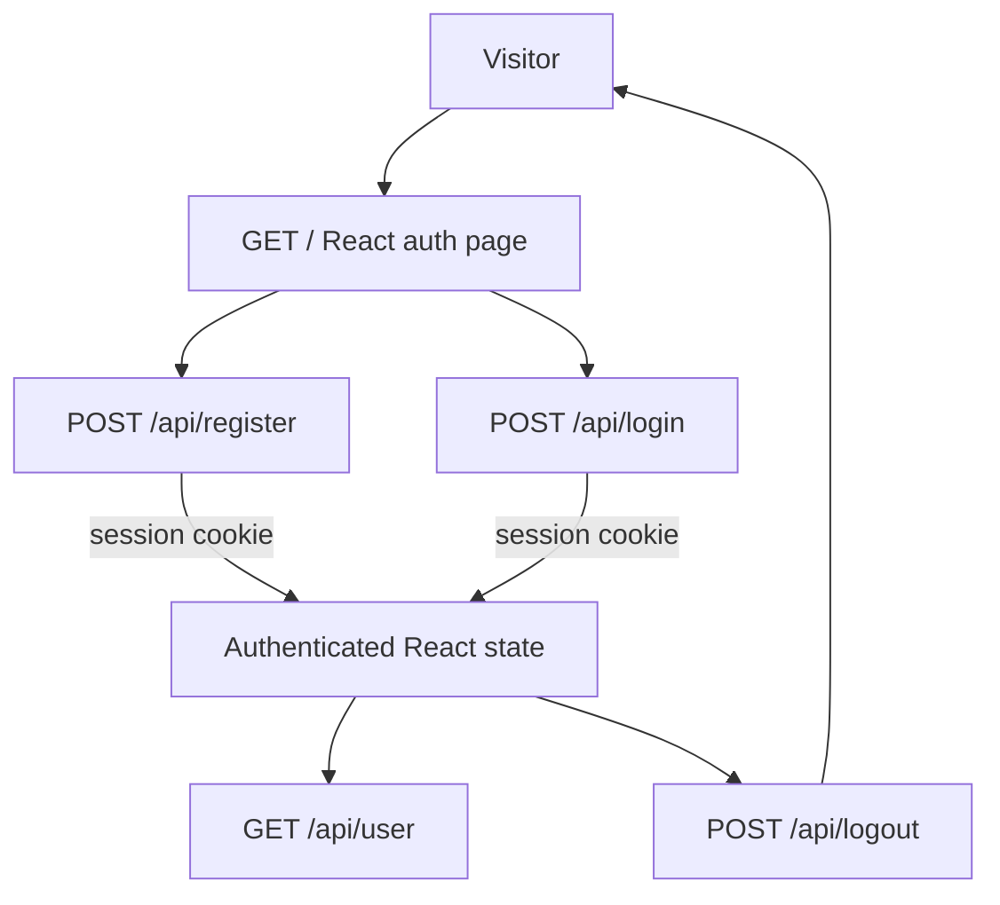
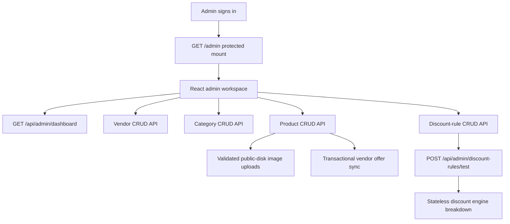

# User Flows

## Current React/API Authentication Flow

The React page first requests `/api/user`; the expected unauthenticated response displays sign-in. Registration and login obtain the Sanctum CSRF cookie before submitting. Logout invalidates the session. Laravel UI web auth and password reset routes remain available separately.

## Existing Web Flow

The route list confirms the Laravel UI login/register, logout, password confirmation/reset, and authenticated home routes. Laravel UI supplies this web flow. Email verification controller and view files exist, but the route list does not expose verification routes.

## Admin Catalog Flow

Admin route mounts require an authenticated admin. Guests are redirected to login, and authenticated non-admins receive 403. Registration cannot set admin status. Vendors are managed as records and never sign in. Category deletion is rejected while products or discount rules reference the category. The discount test panel resolves the selected product/vendor's active offer and runs the engine without writing any data.

Public product browsing, cart, buyer ordering, and vendor notifications remain unimplemented; see [product requirements](requirements.md).