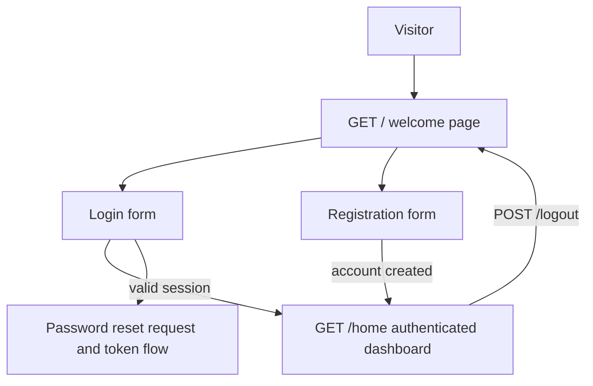

# User Flows

## Current Web Flow

The route list confirms the public welcome, login/register, logout, password confirmation/reset, and authenticated home routes. Laravel UI supplies the auth controller behavior. Email verification controller and view files exist, but the inspected route list does not expose verification routes; do not describe verification as an available workflow without checking configuration and routes again.

## Product Flows Not Yet Defined

No vendor or buyer journey is documented or implemented. Requirements for those flows remain open; see [product requirements](requirements.md).