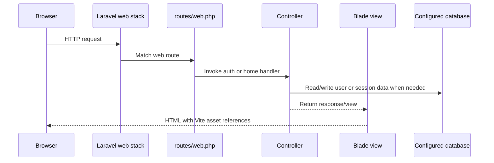
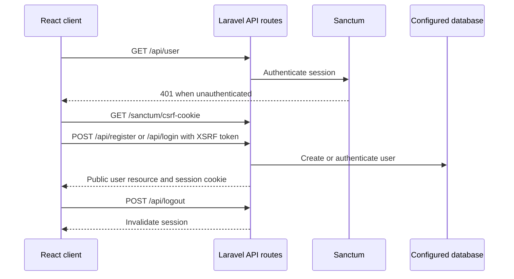
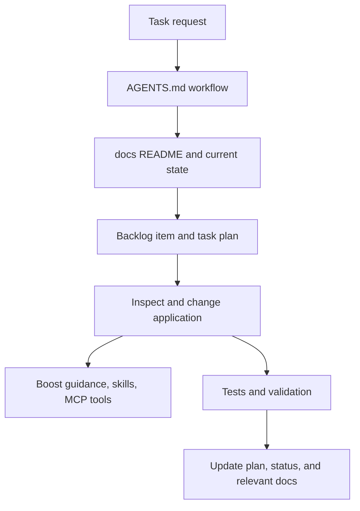

# Request and Data Flow

## Web Request

The root route returns the React mount view; React calls the same-origin API. Sanctum stateful middleware applies session and CSRF behavior to trusted first-party API requests. Laravel UI auth routes remain available, and `/home` is protected by `HomeController`'s `auth` middleware. The exact database connection depends on environment settings: the current runtime connection is MySQL; repository defaults are SQLite.

Admin mount routes use `auth` followed by the admin middleware and return a minimal React host view. Admin React screens call JSON endpoints protected by `auth:sanctum` and the same admin check. Controllers validate requests, write catalog records through Eloquent, and return paginated API resources.

## React Authentication Request

## Agent Context Flow

This is a documentation workflow, not application runtime behavior. See [the canonical workflow](../../AGENTS.md) and [plans](../plans/README.md).