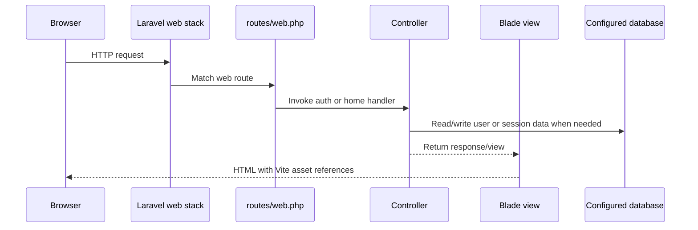
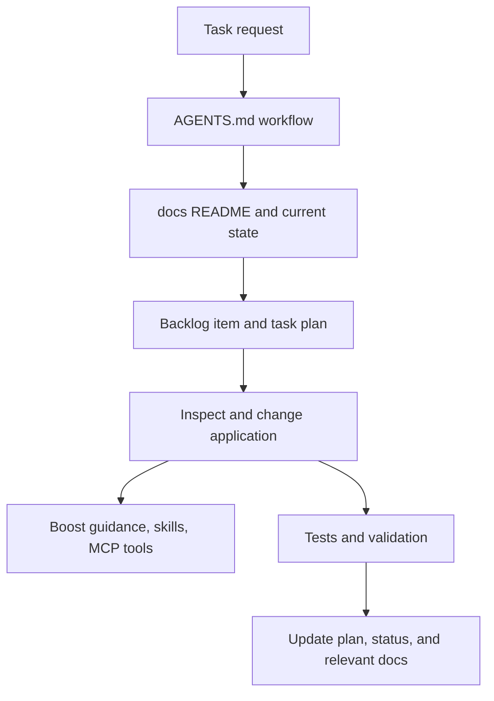

# Request and Data Flow

## Web Request

The welcome route directly returns a view. Auth routes are registered by Laravel UI. `/home` is protected by `HomeController`'s `auth` middleware and returns the home view. The exact database connection depends on environment settings: the current Boost connection reported MySQL; repository defaults are SQLite.

## Agent Context Flow

This is a documentation workflow, not application runtime behavior. See [the canonical workflow](../../AGENTS.md) and [plans](../plans/README.md).